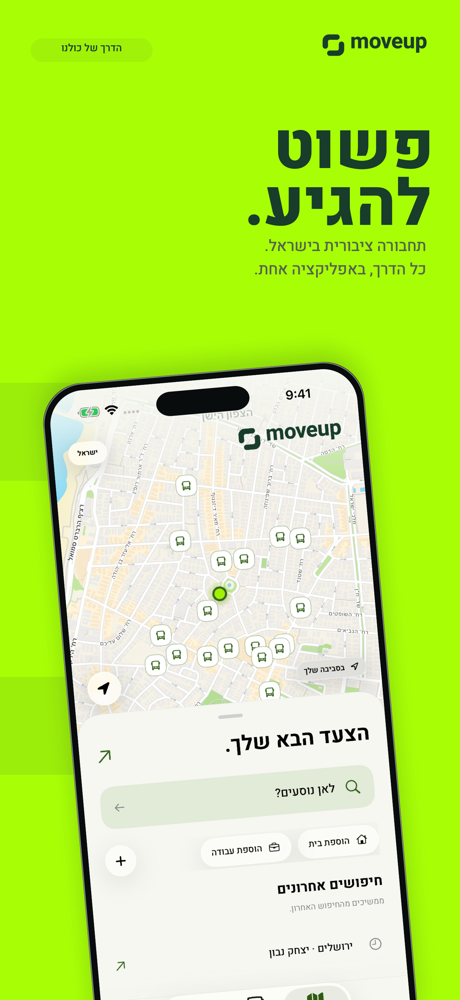
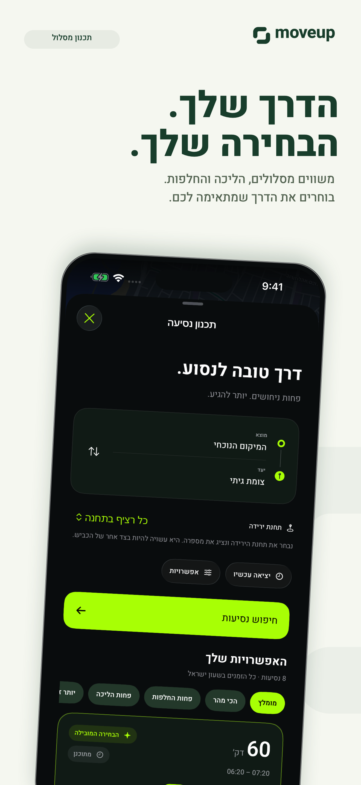
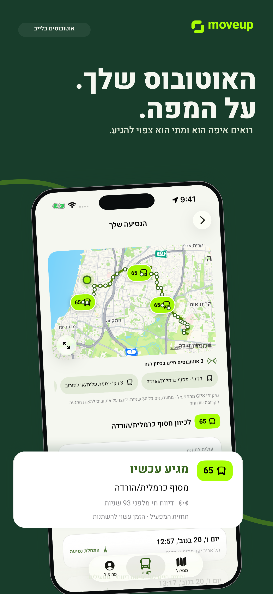
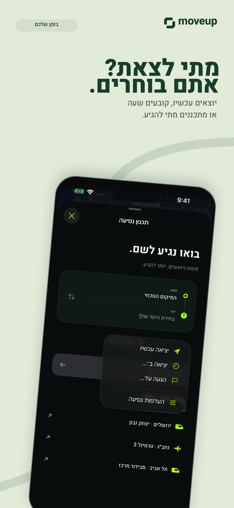
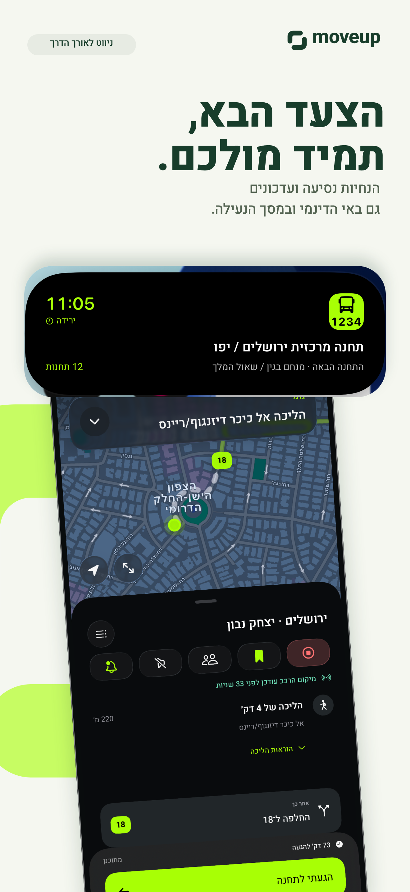
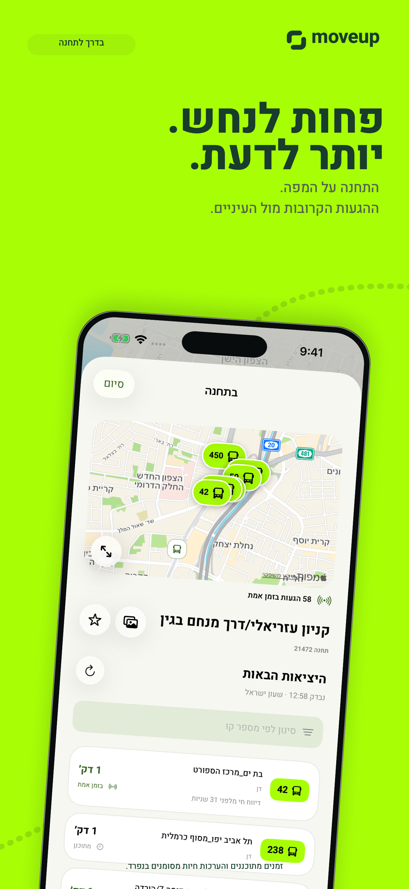
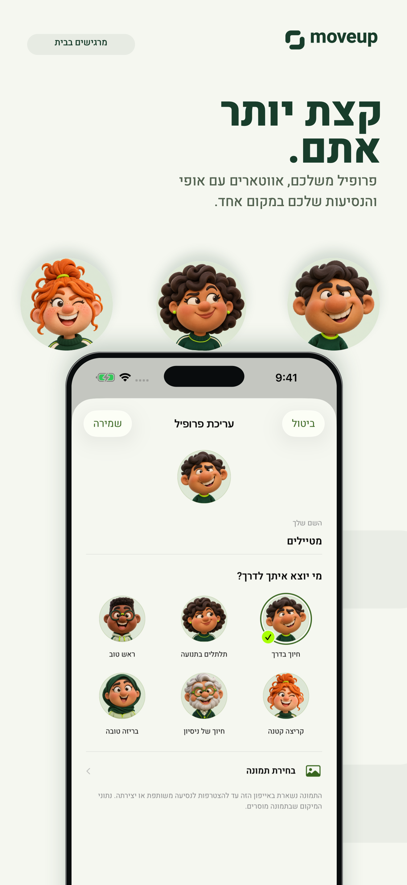
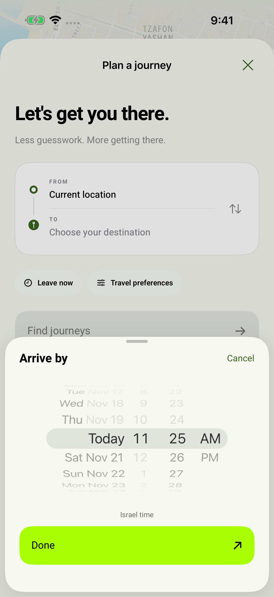
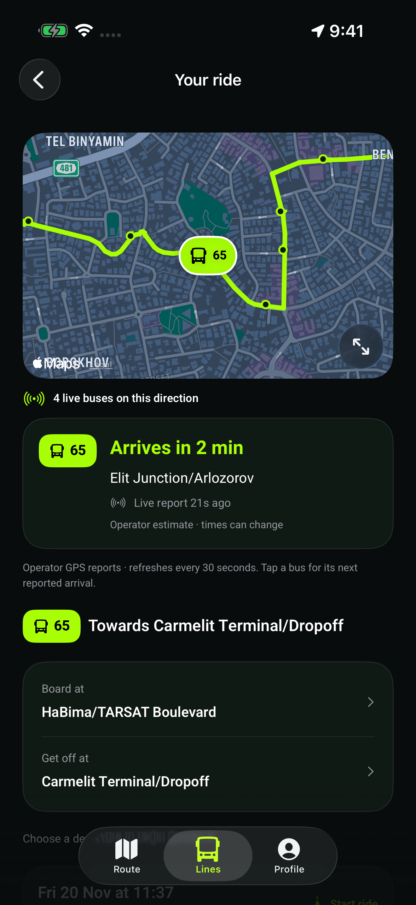

# MoveUp screenshot gallery

**A closer look at the app, in Hebrew and English.**

[Download for iPhone](https://apps.apple.com/il/app/moveup-israel-transit/id6834863987) · [Press kit](PRESS_KIT.md) · [עברית](README.he.md)

These images combine real app captures with approved promotional framing. English images are direct app captures. They show light and dark appearances; journey details are illustrative snapshots, not live transport information. Select an image to open the full-size file.

## Plan, explore and follow your journey

| Simply get there · פשוט להגיע | Choose your route · בוחרים מסלול |
| --- | --- |
|  |  |
| The home map and the next journey. | Compare the options before leaving. |

| Your bus on the map · האוטובוס על המפה | Your time · מתי יוצאים |
| --- | --- |
|  |  |
| Live vehicle information when reports are available. | Leave now, depart later or arrive by a chosen time. |

| The next step · הצעד הבא | At the stop · בתחנה |
| --- | --- |
|  |  |
| Journey information during the trip. | A view of the stop and departure information. |

| Make it yours · קצת יותר אתם | The way, together · הדרך של כולנו |
| --- | --- |
|  |  |
| Personalization with the illustrated avatar family. | An independent, free and ad-free project. |

## English interface

| Arrive by a chosen time | Understand the live report |
| --- | --- |
|  |  |

## Branding

[Download approved logos and read usage guidance](PRESS_KIT.md#approved-brand-assets).

**Created and developed by [Nevo Nadav](CREATOR.md).** [Rights and attributions](RIGHTS.md).
