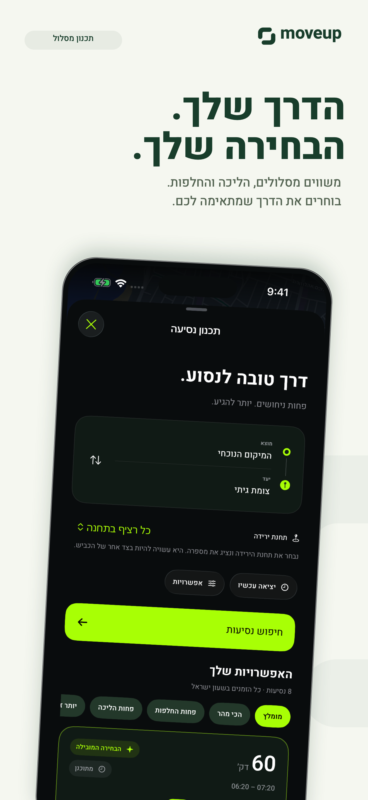
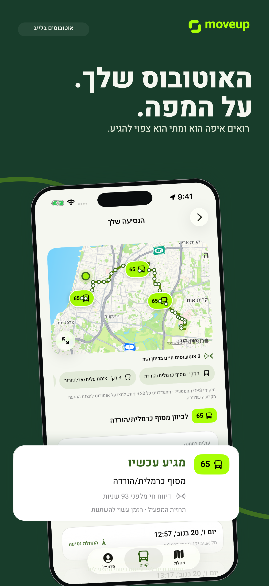
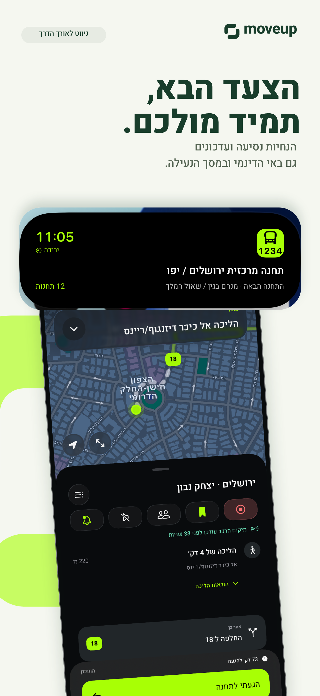

# MoveUp — מובאפ, ניווט בתחבורה ציבורית בישראל

**פשוט להגיע. הדרך של כולנו.**

MoveUp היא אפליקציה חינמית לאייפון ולאנדרואיד, ללא פרסומות, לתכנון נסיעות באוטובוס, ברכבת וברגל בישראל. מתכננים מסלול, מבינים את ההחלפות ומקבלים הכוונה לאורך הדרך — בעברית ובאנגלית. יוזמה ופיתוח: **[נבו נדב — Nevo Nadav](he/CREATOR.md)**.

**[הורדה לאייפון](https://apps.apple.com/il/app/moveup-israel-transit/id6834863987?l=he)** · **[הורדה לאנדרואיד](https://play.google.com/store/apps/details?id=com.nevonadav.moveup&hl=he&gl=IL)** · **[האתר הרשמי](https://moveup.org.il/)** · **[English](README.md)** · **[גלריית תמונות](GALLERY.md)**

גרסת האייפון דורשת iOS 26 ומעלה; התאמת גרסת האנדרואיד למכשיר מוצגת ב־Google Play. השימוש באפליקציה חינמי; תשלום על הנסיעות מתבצע בנפרד.

## הדרך ברורה, עוד לפני שיוצאים

נסיעה בתחבורה ציבורית היא יותר ממספר של קו. צריך להבין לאיזו תחנה ללכת, באיזה כיוון לעלות וכמה זמן נשאר להחלפה. MoveUp מרכזת את המידע הזה בחוויה רגועה שמבוססת על מפה, עם הבחנה ברורה בין דיווח חי ללוח הזמנים המתוכנן.

הצילומים מציגים את המוצר; זמני הנסיעה והמידע בהם הם להמחשה ואינם עדכון חי.

## מה אפשר לעשות באפליקציה?

- **לתכנן את הדרך:** להשוות מסלולים לפי זמן הגעה, הליכה והחלפות.
- **לבחור מתי נוסעים:** לצאת עכשיו, לקבוע יציאה מאוחרת או לתכנן לפי שעת הגעה.
- **להבין את ההחלפה:** לראות גם את ההליכה בין התחנות ואת הזמן שנשאר אחריה.
- **למצוא את הקו:** לחפש קווים ותחנות, לבדוק כיוון נסיעה ולצפות ביציאות.
- **לראות מידע בזמן אמת:** זמני הגעה ומיקומי אוטובוסים כשיש דיווחים זמינים ועדכניים.
- **לקבל הכוונה בדרך:** מפה, הנחיות קוליות לבחירה, תזכורות ירידה ועדכוני נסיעה. פעילויות חיות באייפון; התראות נסיעה ו־Live Updates באנדרואיד במכשירים תומכים.
- **להקל על הנסיעות הקבועות:** לשמור מקומות מועדפים ולחזור לחיפושים אחרונים.
- **לעזור לנוסעים אחרים:** דיווחי עומס, שיתוף נסיעה עם אנשים שבוחרים ותמונות תחנות לאחר התחברות.

[כל יכולות האפליקציה](he/FEATURES.md) · [שאלות נפוצות](he/FAQ.md)

## מתחילים בנסיעה הקרובה

1. מורידים את MoveUp מה־App Store או מ־Google Play.
2. בוחרים יעד ומתי רוצים לנסוע.
3. משווים את המסלול כולו, כולל ההליכה וההחלפות.
4. מתחילים ניווט ועוקבים אחרי השלב הבא. לפני העלייה בודקים את כיוון הנסיעה ואת היעד שעל הרכב.

אפשר לתכנן מסלול ולהשתמש בניווט כאורחים. תכונות קהילתיות מסוימות דורשות התחברות.

## קצת סדר בדרך

- [תכנון מסלול באוטובוס וברכבת](he/plan-a-journey.md)
- [מתי האוטובוס מגיע? זמן אמת ולוח זמנים](he/live-arrivals.md)
- [החלפת אוטובוסים ורכבות: האם אספיק?](he/transfers.md)
- [כל המדריכים באתר](https://moveup.org.il/guides/)

## האדם שמאחורי MoveUp

**נבו נדב** הוא היוצר והמפתח העצמאי של MoveUp. הפרויקט מתמקד בשאלות שמלוות נסיעה יומיומית: איפה עולים, מתי מחליפים ומה באמת יודעים על זמן ההגעה. המשוב של הנוסעים עוזר לשפר את החוויה.

[על נבו נדב](he/CREATOR.md) · [דף היוצר הרשמי](https://moveup.org.il/nevo-nadav/) · [ערכת עיתונות](PRESS_KIT.md)

## נשארים בקשר

[האתר הרשמי](https://moveup.org.il/) · [האינסטגרם של MoveUp](https://www.instagram.com/startmoveup/) · [בלוג הפרויקט](https://moveup.org.il/blog/) · [תמיכה ומשוב](SUPPORT.md)

לפניות על האפליקציה ושיתופי פעולה: [moveup.israel@gmail.com](mailto:moveup.israel@gmail.com).

MoveUp היא יוזמה עצמאית, ואינה שירות רשמי של משרד התחבורה או של מפעיל תחבורה. מידע חי תלוי בנתונים הזמינים. האפליקציה אינה מוכרת כרטיסים ואינה מתקפת נסיעות. MoveUp זמינה ב־App Store וב־Google Play. התכונות ועדכוני הרקע תלויים במכשיר ובמערכת ההפעלה.

המאגר הזה הוא מרכז התוכן והתדמית הציבורי של MoveUp. הוא כולל מידע על המוצר, מדריכים ותמונות נבחרות. קוד האפליקציה, מפתחות, מערכות שרת ונתונים פרטיים אינם כלולים בו.

© 2026 נבו נדב. [זכויות בתוכן ובנכסי המותג](RIGHTS.md).

