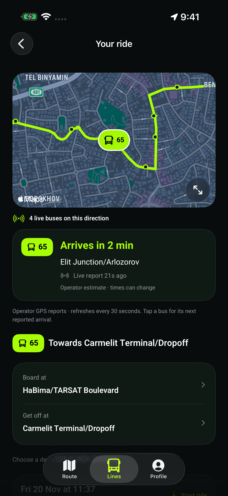

# Live bus arrivals, scheduled times and vehicle positions

[עברית](../he/live-arrivals.md) · [MoveUp](../README.md)

Three pieces of transport information can look similar on a screen while answering different questions. Knowing the difference helps you decide what to rely on.

| Information | What it tells you | What it does not promise |
| --- | --- | --- |
| Scheduled departure | When a service is planned to leave. | That the vehicle is on time or already nearby. |
| Live arrival estimate | An estimated arrival based on available fresh reports. | An exact arrival time that cannot change. |
| Vehicle position | Where a vehicle was reported. | That its distance alone determines your wait. |

## Why an estimate changes

A bus may wait at stops, encounter congestion or take longer than expected to move through a junction. New reports can therefore change the estimate. A live label means information is based on reports, not that the remaining time is guaranteed.

## Why a vehicle can disappear from the map

MoveUp needs a usable recent report to show live vehicle information. Reports may be missing or no longer fresh enough. A missing marker alone does not establish that the service is cancelled or has passed your stop.

## What to check at the stop

Read the destination and direction, then check whether the time is live or scheduled. Look for the report age where displayed. If there is no live information, use the timetable as a plan and check operator notices for important changes.

## How MoveUp presents the distinction

The app distinguishes planned times from live information and displays bus positions when suitable reports are available. This keeps the source of the information visible instead of making every countdown look equally certain.

Illustrative app capture; this is not a live departure board.

[Official live-arrivals guide](https://moveup.org.il/en/guides/live-arrivals/) · [Plan a journey](plan-a-journey.md) · [FAQ](../FAQ.md)
